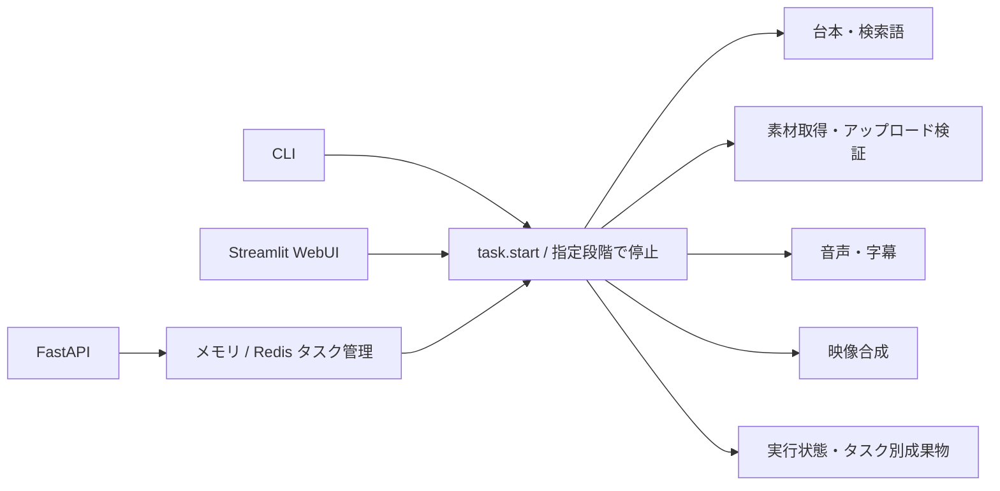

# リポジトリ全体のレビュー記録

対象: `nyu1791-collab/MoneyPrinterTurbo-Foundation`  
開始時コミット: `2a837b7f99326a6d39a227bd3f8629e431988b48`  
実施日: 2026-10-20 UTC  
役割: Gemini 3.8 Flashが静的なコード調査・提案、Codexが照合・再現・修正・実行検証。

## 対象範囲と方法

開始時の追跡対象410ファイルを分類し、テキスト353ファイル（4,060,892文字）を、省略せず10組に分けてVertex AI `gemini-3.8-flash` へ渡した。全10応答が同モデルで `STOP` に到達した。別モデルへの切替・自動再試行はない。各組には全体のファイル一覧とVMルールを添付した。Geminiには実行・編集・外部検索ツールを渡していない。

コード、設定、Docker/Actions、CLI/WebUI、文書、テスト、翻訳定義が対象。除外57ファイルは画像・音声・フォントなどのバイナリ56件と、生成された依存ロック `uv.lock` 1件。ロックは別途 `uv lock --check --offline` で整合性を確認した。画像の見た目・音の品質・フォントの描画結果を確認したという意味ではない。

[全ファイルの対象一覧](whole-review-coverage.json)と[モデル実行記録](whole-review-receipt.json)を参照。Git外の私有設定・認証情報は送信していない。

## 構造

- API認証と生成ファイル保護: `app/asgi.py`、`app/controllers/`
- 台本/API選択: `app/services/llm.py`、`app/models/llm_provider.py`
- タスクと実行状態: `task.py`、`state.py`、`controllers/manager/`
- 素材・音声・字幕・描画: `app/services/` の各実装
- WebUI/CLIと設定: `webui/`、`cli.py`、`app/config/`
- 配布・起動: Docker/Compose、`pyproject.toml`、起動スクリプト、Actions

既存の外部投稿連携やGPU用Docker定義もコピー元から残っている。今回それらを起動・追加設定していない。公開GitHubへのコード保存と、動画や認証情報の公開を混同しない。Actionsは引き続きリポジトリ単位で無効。

## 再現して修正した事項

| 事項 | 根拠と修正 | 確認範囲 |
| --- | --- | --- |
| 字幕類似度の空文字同士でゼロ除算 | Geminiの指摘を `similarity("", "")` で再現。両方空なら完全一致1.0を返す | ヘルパーの境界条件。通常の字幕校正経路が必ずクラッシュするとは主張しない |
| OAuthでJSONオブジェクト以外を受信した際の未処理例外 | Geminiのポーリング例外指摘をCodexが追跡し、配列/null/文字列等でAttributeError等を再現。共通パーサーで安全なValueErrorに変換 | デバイス認証・ポーリング・更新。既存UIのValueError処理へ渡せる |
| OAuth異常応答の内容露出 | 同じ調査中にCodexが追加確認。プロバイダ本文・error_description等が例外文へ出ることを偽の応答で再現。本文を出さず処理名とHTTP状態を返す | このOAuthモジュールの異常応答。プロジェクト全ログの完全な秘密値除去を保証しない |

22件の追加回帰ケースが修正前に失敗し、修正後に通過した。OAuthの正常応答・pending/slow_down/expired/denied・トークン保存・更新・並行制御の既存テストも維持した。任意のExceptionをまとめて握り潰す変更は行っていない。

## 採用しなかった主な指摘

Geminiの回答は未検証の提案として扱った。次の指摘をそのままコード変更へ変換していない。

| 指摘 | Codexによる照合・判断 |
| --- | --- |
| `UV_LOCK_TIMEOUT` は無効で `UV_CACHE_LOCK_TIMEOUT` が必要 | VMのuvバイナリは前者を認識し後者は含まない。置換の根拠なし |
| ファイルを二度closeすると、再利用されたFDを閉じる | 同じPython IOオブジェクトのcloseは冪等。未開始ストリームの後処理も維持する |
| MP4は既存のmovホワイトリストで常に拒否される | 一時的な正常MP4テスト素材を作成し、現行の実検証が受理することを確認。ホワイトリスト拡大不要 |
| Streamlit link_buttonにon_click/argsは存在しない | 固定依存Streamlit 1.59.1の実際のシグネチャには両方存在する |
| スクリプト段階でも音声ファイルの検証を必須化すべき | その段階では音声を消費しない既存仕様。無関係な資産を必須にする変更はしない |
| シェルの `uv run streamlit run` はrun重複で不正 | uvとStreamlitそれぞれのサブコマンドであり、引数構成は正しい |
| BGMプリセットからローカルファイルが漏れる | ローカルパスは明示的に除外されている。勝手にrandomへ切り替える変更はしない。別PCの私有素材は再選択が必要 |
| 短いポーズで字幕が必ずずれる | 入力パーサーが最低長を適用済み。モック前提の経路を本番の確定不具合とは扱わない |
| 台本入力の改行を除けばプロンプト注入を解決できる | 利用者が内容や追加指示を指定する機能であり、改行除去だけの安全性は立証されない |
| TOML置換でコメントが落ちるため設定を破壊する | コメント保持は改善余地だが、挙げられた正常入力で構文破壊は立証されない。今回は変更しない |

## 実行検証と限界

- 依存ロックのオフライン整合性確認: 成功。
- Pythonツリー全体のRuff: 成功。
- 修正対象と既存字幕/OAuthテスト: **74 passed、5 subtests passed**。
- 開始時コードを基準とするVM全体テスト: **2,401 passed、54 skipped、21 warnings、10,956 subtests passed、595.14秒**。54件は検証済みに数えない。全体実行の収集後に新しい22回帰ケースを追加・修正したため、修正後は関連74件で再検証し、全体テストの二度目の実行は行っていない。
- 以前のAntigravityサンドボックスでの49件失敗は、この直接VM実行では再現しなかった。全体テストはexit0。
- productionの動画・音声、実アカウントのOAuthログイン、外部投稿、GPU、GitHub-hosted CIは未実施。
- 複数組に分けた静的レビューであり、Gemini各応答が全コードを一度に文脈へ保持したわけではない。全不具合の不存在や本番稼働を保証しない。
- APIキー未設定時の免認証モードなど、コピー元の互換仕様は残る。初期運用はローカルまたは信頼できるネットワークに限定する。
